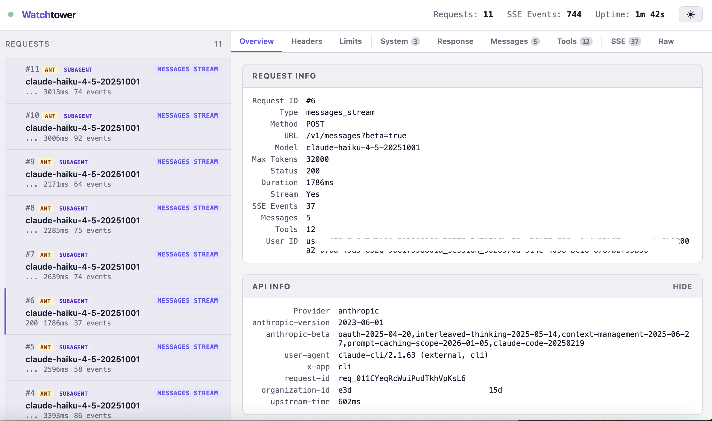

# Watchtower

Monitor, inspect, and debug all API traffic between AI coding agents and their APIs — with a real-time web dashboard.

> Like Chrome DevTools Network tab, but for Claude Code and Codex CLI.



## Why

AI coding agents make dozens of API calls per interaction — streaming messages, token counts, quota checks, subagent spawns — and you can't see any of it. Watchtower sits between your AI agent and its API, captures everything, and gives you a live dashboard to inspect it all.

**Works with:**
- [Claude Code](https://docs.anthropic.com/en/docs/claude-code) (Anthropic)
- [Codex CLI](https://github.com/openai/codex) (OpenAI)
- Any OpenAI-compatible client

**What you see:**

- Every request and response, fully decoded
- SSE stream events in real time
- **Live cost & token tracker** — cumulative session cost and token count in the header, plus per-request cost from model list prices
- **Search & filter** — full-text search across models, types, tools, and message content; hide `token_count`/`quota_check` noise; show errors only
- **Conversation grouping** — fold each turn's utility calls and subagents under its main request
- **System-prompt & turn diffs** — see exactly what changed vs the previous request
- **Replay & breakpoints** — re-send a captured request (optionally edited), or pause requests in-flight to edit or drop them ("Burp Suite for Claude")
- **Copy buttons** on every JSON block, system prompt, and message
- Agent hierarchy tracking (main agent → subagents → utility calls)
- Token usage, rate limits, and timing
- System prompts, tool definitions, full message history
- **Reveal hidden extended thinking** — optionally rewrite requests so the API streams thinking summaries (see [Reveal thinking](#reveal-hidden-thinking))
- Dark and light mode
- All logged to disk as JSON for later analysis

Zero runtime dependencies — it's a single script plus a self-contained dashboard. No `npm install`, no build step.

## Quick Start

```bash
npm install -g watchtower-ai
watchtower-ai
```

Or clone and run directly — there are no dependencies to install:

```bash
git clone https://github.com/fahd09/watchtower.git
cd watchtower
node intercept.mjs
```

Then point your AI agent at the proxy:

```bash
# Claude Code
ANTHROPIC_BASE_URL=http://localhost:8024 claude

# Codex CLI (API-key auth)
OPENAI_BASE_URL=http://localhost:8024 codex
```

Open **http://localhost:8025** — that's it. Both providers share the same proxy port. Requests are auto-detected.

> **Codex with a ChatGPT login (subscription auth)?** `OPENAI_BASE_URL` is ignored in that mode — Codex talks straight to `chatgpt.com` and the proxy never sees it. See [Codex + ChatGPT auth](#codex--chatgpt-account-auth) for the one-time profile setup.

### Codex + ChatGPT account auth

When Codex is logged in with a ChatGPT account (`auth_mode: chatgpt`), it sends its Responses API traffic directly to `chatgpt.com/backend-api/codex` and **ignores `OPENAI_BASE_URL`** — so pointing that env var at the proxy does nothing. Instead, add an opt-in Codex profile that routes the model calls through Watchtower while keeping your ChatGPT login.

Save this as `~/.codex/watchtower.config.toml` (also included in the repo as [`docs/codex-watchtower.toml`](docs/codex-watchtower.toml)):

```toml
model_provider = "watchtower"

[model_providers.watchtower]
name = "watchtower"
base_url = "http://localhost:8024"   # match your Watchtower proxy port
wire_api = "responses"
requires_openai_auth = true          # keep the ChatGPT OAuth token + account id
```

Then run Codex through the proxy:

```bash
codex --profile watchtower
```

Codex still attaches your ChatGPT OAuth token (`requires_openai_auth`); Watchtower forwards the request to `chatgpt.com` and captures it. Your default `config.toml` and the API-key `OPENAI_BASE_URL` path are untouched — it's opt-in per run.

## Usage

```bash
# Default ports: proxy=8024, dashboard=8025
node intercept.mjs

# Custom ports
node intercept.mjs 9000 9001
```

### Dashboard Tabs

| Tab | What it shows |
|-----|--------------|
| **Overview** | Duration, model, status, token counts, estimated cost, TTFT/throughput, context-window gauge, rate limits |
| **Messages** | Full conversation history (user/assistant messages) |
| **Turn Diff** | What changed in the messages vs the previous request |
| **Sys Diff** | Line-level diff of the system prompt vs the previous request |
| **Response** | Pretty-printed response JSON |
| **Tools** | Tool definitions with searchable parameters and schemas |
| **Stream** | Raw SSE events with expandable payloads |
| **Headers** | Request and response headers |
| **Rate Limits** | Rate limit headers with visual progress bars |
| **Raw** | Complete request/response bodies as JSON |

### Request Classification

The proxy automatically classifies each request:

**Anthropic:**
- `messages_stream` — Streaming chat (the main interaction)
- `messages` — Non-streaming chat
- `token_count` — Token counting
- `quota_check` — Quota/permission check (`max_tokens=1`)

**OpenAI:**
- `responses_stream` / `responses` — Responses API (Codex CLI default)
- `chat_stream` / `chat_completion` — Chat Completions API
- `models` — Model listing
- `embeddings` — Embedding requests

### Agent Roles

Each request is tagged with an agent role:

- **main** — The primary agent (Claude Code's main agent has the `Agent` tool; Codex requests with tools)
- **subagent** — A spawned sub-agent (Explore, Plan, etc.)
- **utility** — Token counts, quota checks, and tool-less calls

### Cost & Token Tracking

The header bar shows the running **token count** and **estimated cost** for the whole session, computed from each model's list price. Every request also shows its own cost in the Overview and Response tabs. Cache reads (~0.1×) and cache writes (~1.25×) are priced separately from fresh input. Unknown models show `—` instead of a wrong number.

### Replay & Breakpoints

**Replay** — open any captured request, click **Replay / edit request**, tweak the body (system, messages, tools, parameters), and send it upstream reusing the original request's auth. The result is captured as a new request tagged with a ↻ badge. Great for reproducing issues or A/B-testing a prompt change.

**Breakpoints** — flip the **Breakpoints** toggle in the sidebar and chat requests pause *before* being forwarded. A modal shows the request body: edit it and **Forward**, or **Drop** it entirely (the client gets a 499). Like Burp Suite, but for AI agents. Off by default; if the dashboard disconnects, breakpoints auto-disable and any paused requests are released so nothing hangs.

> Replays and edited/dropped requests use the real upstream auth, which Watchtower keeps **in memory only** — never written to the JSON logs.

### Reveal hidden thinking

On recent models (Opus 4.8/4.7, Sonnet 5, Fable 5), Claude Code requests extended thinking with `display: "omitted"` — the model reasons, but the API returns only a cryptographic signature, not the thinking text. Watchtower shows an empty thinking block by default and explains why.

To capture the reasoning, start the proxy with request rewriting enabled:

```bash
WATCHTOWER_REVEAL_THINKING=1 node intercept.mjs
```

This transparently rewrites Anthropic requests from `display: "omitted"` to `"summarized"`, so the API streams a readable summary of the reasoning — which then appears in the dashboard. Off by default, so the proxy stays byte-for-byte transparent unless you opt in.

### Logs

All requests are saved to `./logs/` as numbered JSON files:

```
logs/0001_messages_stream_claude-opus-4-6.json
logs/0002_token_count_claude-haiku-4-5-20251001.json
```

Each file contains the complete request/response cycle: headers, body, SSE events, timing, and rate limits.

## How It Works

```
Claude Code  ──HTTP──┐
                     ├──>  Watchtower (proxy)  ──HTTPS──>  api.anthropic.com
Codex CLI    ──HTTP──┘          │              ──HTTPS──>  api.openai.com / chatgpt.com
                                │
                                ├── logs to disk
                                ├── broadcasts via WebSocket
                                │
                          Dashboard (web UI)
```

1. Your AI agent sends requests to the local proxy instead of directly to the API
2. Watchtower auto-detects the provider and forwards to the correct upstream
3. Responses (including SSE streams) are decoded, logged, and forwarded back
4. The dashboard connects via WebSocket for real-time updates

## Requirements

- Node.js >= 22 (uses the built-in crypto/streams; no npm dependencies)

## Roadmap

Recently shipped:

- ✅ Cost & token tracking
- ✅ Search & filter (sidebar) + copy buttons
- ✅ Conversation grouping (fold each turn's requests into one unit)
- ✅ System-prompt diff & turn diff (what changed vs the previous request)
- ✅ Request replay & breakpoints (edit/drop in-flight — Burp Suite for Claude)
- ✅ Zero-dependency (dropped the `ws` package)
- ✅ Transparent gzip pass-through (forwards original bytes to the client)
- ✅ Reveal hidden extended thinking (request rewriting)
- ✅ Observability: TTFT, throughput (tok/s), context-window gauge

Planned:

- Agent hierarchy tree visualization
- Export (session/request as JSON, HAR, or HTML)

## Contributing

Contributions welcome. Open an issue first for anything non-trivial.

```bash
git clone https://github.com/fahd09/watchtower.git
cd watchtower
node intercept.mjs
```

The proxy is in `intercept.mjs`, the zero-dependency WebSocket server in `ws-server.mjs`, provider logic in `providers/`, and the dashboard is a single `dashboard.html`. No dependencies, no build step, no bundler.

## License

[MIT](LICENSE)
